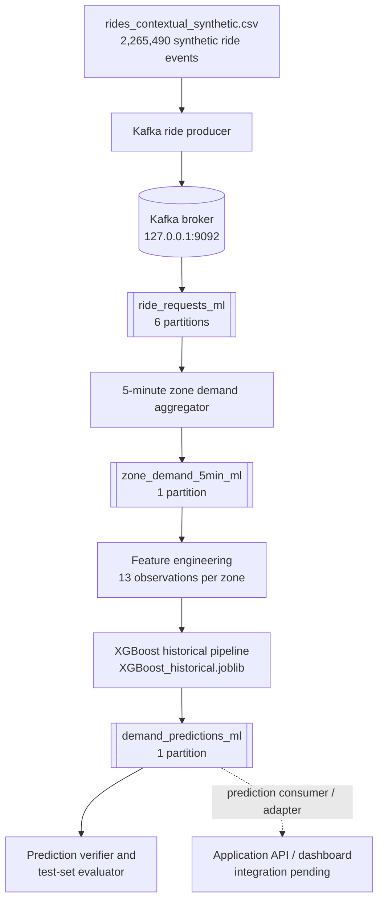

# Bengaluru Ride-Hailing Demand Prediction — Kafka + XGBoost Pipeline

A Kafka-based data-ingestion and machine-learning pipeline that converts individual ride requests into **5-minute pickup-zone demand counts** and predicts the **total ride requests expected in each zone over the next 15 minutes**.

This README documents the dataset preparation, model training, Kafka ingestion, zone-wise aggregation, XGBoost inference, validation, evaluation, and current integration status for the ML/Kafka component of the Bengaluru Demand Command project.

> **Project status:** The historical replay pipeline, XGBoost inference, structural validation, and comparison against the saved offline model have completed successfully. The current implementation is a **historical Kafka replay prototype**, not yet a continuously running production stream or a live ride-hailing service. The output topic is ready for integration with the application backend/dashboard.

---

## Contents

- [1. Project objective](#1-project-objective)
- [2. What this component does](#2-what-this-component-does)
- [3. Architecture and data flow](#3-architecture-and-data-flow)
- [4. Dataset](#4-dataset)
- [5. Kafka topics and message flow](#5-kafka-topics-and-message-flow)
- [6. Five-minute zone aggregation](#6-five-minute-zone-aggregation)
- [7. ML feature engineering and forecast definition](#7-ml-feature-engineering-and-forecast-definition)
- [8. Model training and evaluation methodology](#8-model-training-and-evaluation-methodology)
- [9. Kafka inference results](#9-kafka-inference-results)
- [10. Validation and model-reproduction results](#10-validation-and-model-reproduction-results)
- [11. Technology stack](#11-technology-stack)
- [12. Project files](#12-project-files)
- [13. Local setup](#13-local-setup)
- [14. Run the pipeline](#14-run-the-pipeline)
- [15. Inspect Kafka topics, partitions, and consumer groups](#15-inspect-kafka-topics-partitions-and-consumer-groups)
- [16. Output message formats](#16-output-message-formats)
- [17. Integration handoff to the application/dashboard](#17-integration-handoff-to-the-applicationdashboard)
- [18. Current limitations and next steps](#18-current-limitations-and-next-steps)
- [19. Interpretation and responsible use of results](#19-interpretation-and-responsible-use-of-results)

---

## 1. Project objective

The objective is to build a streaming-oriented pipeline for **zone-level ride-hailing demand prediction in Bengaluru**.

For each of the 52 pickup zones, the system:

1. Receives individual ride-request events through Apache Kafka.
2. Aggregates ride requests into consecutive 5-minute windows.
3. Maintains recent demand history separately for every pickup zone.
4. Uses a trained XGBoost regression model to predict the total demand in the **following 15 minutes**.
5. Publishes one prediction record per zone and prediction origin to Kafka.

The intended application use case is to help an operations dashboard identify areas likely to experience higher ride demand. The predictions could support driver positioning and operational planning, but the current project does not dispatch drivers or make actual fleet-allocation decisions.

## 2. What this component does

This repository component covers the **data and ML backend**:

- Synthetic ride-data preparation and zone/time demand dataset generation.
- Historical and contextual feature engineering.
- Model training and chronological evaluation.
- Kafka ride-event producer.
- Kafka consumer/aggregator for 5-minute zone demand.
- Kafka consumer for XGBoost inference.
- Prediction-topic validation.
- Evaluation of Kafka-generated predictions against the original chronological test set and saved offline XGBoost predictions.

The web dashboard, application API, persistent database, and final deployment integration are separate application-layer tasks. They are not claimed as completed by this pipeline.

## 3. Architecture and data flow



### Main stages

| Stage | Input | Processing | Output |
|---|---|---|---|
| Ride ingestion | `rides_contextual_synthetic.csv` | Convert CSV rows to JSON ride events and publish to Kafka | `ride_requests_ml` |
| Demand aggregation | `ride_requests_ml` | Group events by 5-minute event-time window and pickup zone | `zone_demand_5min_ml` |
| ML inference | `zone_demand_5min_ml` | Build historical features and run XGBoost | `demand_predictions_ml` |
| Validation/evaluation | `demand_predictions_ml` plus original ML dataset | Validate completeness and compare predictions with held-out actual targets | CSV/JSON evaluation reports |

The broker is currently a local Kafka broker on `127.0.0.1:9092`. The three ML topics use the `_ml` suffix to keep this pipeline separate from earlier test topics and from the topic names used by the separate dashboard/backend implementation.

## 4. Dataset

### Ride-event source

The primary event source is:

```text
rides_contextual_synthetic.csv
```

Dataset characteristics used in the successful pipeline run:

| Property | Value |
|---|---:|
| Ride events | 2,265,490 |
| Pickup zones | 52 |
| Date range | 1 July 2026 – 29 August 2026 |
| Calendar duration | 60 days |
| Aggregation interval | 5 minutes |
| Time zone | Asia/Kolkata (IST, UTC+05:30) |

The ride data is **synthetic**. It is suitable for developing and testing ingestion, aggregation, feature engineering, model inference, and application integration. It must not be represented as actual ride-hailing company telemetry or measured Bengaluru demand.

### Supporting data used during dataset preparation

The ML dataset builder also uses:

- `weather_data.csv`
- `bengaluru_events.csv`

These files are used to create contextual attributes in the prepared ML dataset. The selected production-style inference model in this pipeline is the **historical-only XGBoost model**, so its 17 features do not require weather or event fields.

### Prepared ML dataset

The dataset builder creates:

```text
zone_demand_5min.csv
```

It contains zone/time rows, historical demand features, time features, contextual fields, and `Target_Next_15min`. The training script reports 897,780 ML rows across 52 zones and 17,265 unique prediction timestamps after removing incomplete history/target rows.

## 5. Kafka topics and message flow

The successful ML run used these topics:

| Topic | Partitions | Replication factor | Purpose | Records in successful run |
|---|---:|---:|---|---:|
| `ride_requests_ml` | 6 | 1 | Individual ride-request events | 2,265,490 |
| `zone_demand_5min_ml` | 1 | 1 | One demand count per zone per 5-minute window | 898,560 |
| `demand_predictions_ml` | 1 | 1 | One 15-minute forecast per zone and prediction origin | 897,936 |

The one-partition configuration of the aggregation and prediction topics preserves a single ordered sequence of complete zone windows for the current inference implementation. This is a deliberate ordering choice for this prototype. The ride-event topic uses six partitions, with pickup zone as the message key.

### Why three topics?

- `ride_requests_ml` stores the fine-grained source events.
- `zone_demand_5min_ml` stores the intermediate aggregated demand signal.
- `demand_predictions_ml` stores the ML output intended for downstream consumers, such as the application API or dashboard.

The topics are separate Kafka streams. A consumer reads from one topic and the corresponding producer publishes to the next topic.

## 6. Five-minute zone aggregation

The aggregator consumes individual ride events and uses the event timestamp to assign each ride to a 5-minute interval.

For a ride timestamp `10:02:30`, the event belongs to the interval:

```text
Window start: 10:00:00
Window end:   10:05:00
```

The aggregator counts rides using:

```text
(window_start, pickup_zone_id) -> ride_count
```

A complete calendar is generated for the dataset range. For every time window, the aggregator emits a record for all 52 zones, including zones with zero rides in that interval.

Successful aggregation totals:

| Measure | Result |
|---|---:|
| Calendar start | `2026-07-01T00:00:00+05:30` |
| Final window start | `2026-08-29T23:55:00+05:30` |
| Number of 5-minute windows | 17,280 |
| Zones per window | 52 |
| Output records | 17,280 × 52 = **898,560** |
| Ride events consumed | **2,265,490** |

The `window_end` is the prediction origin: the demand in the interval that has just completed is available at that timestamp.

## 7. ML feature engineering and forecast definition

### Forecast definition

At prediction origin `T`, the model predicts the **total number of requests during the next three 5-minute intervals**:

```text
Target_Next_15min = demand(T to T+5)
                  + demand(T+5 to T+10)
                  + demand(T+10 to T+15)
```

The target is a 15-minute total, not a five-minute count and not a demand rate.

### Selected model features

The selected model is `XGBoost_historical.joblib`. It expects the following 17 input columns in the training feature schema:

| Group | Feature | Definition |
|---|---|---|
| Time | `Hour` | Hour of the prediction origin (0–23) |
| Time | `Day_Of_Week` | Day of week, Monday = 0 and Sunday = 6 |
| Time | `Is_Weekend` | 1 for Saturday/Sunday, otherwise 0 |
| Cyclical time | `Hour_Sin` | `sin(2π × hour / 24)` |
| Cyclical time | `Hour_Cos` | `cos(2π × hour / 24)` |
| Cyclical time | `DayOfWeek_Sin` | `sin(2π × day_of_week / 7)` |
| Cyclical time | `DayOfWeek_Cos` | `cos(2π × day_of_week / 7)` |
| Current demand | `Demand_Last_5min` | Ride count in the latest completed 5-minute interval |
| Demand lag | `Demand_Lag_5min` | Demand one 5-minute interval earlier |
| Demand lag | `Demand_Lag_10min` | Demand two intervals earlier |
| Demand lag | `Demand_Lag_15min` | Demand three intervals earlier |
| Demand lag | `Demand_Lag_30min` | Demand six intervals earlier |
| Demand lag | `Demand_Lag_60min` | Demand twelve intervals earlier |
| Rolling demand | `Rolling_Mean_15min` | Mean of the latest three completed intervals, including the current interval |
| Rolling demand | `Rolling_Mean_30min` | Mean of the latest six completed intervals, including the current interval |
| Rolling demand | `Rolling_Mean_60min` | Mean of the latest twelve completed intervals, including the current interval |
| Zone | `Zone_ID` | Pickup-zone identifier; treated as categorical by the saved preprocessing pipeline |

The inference consumer maintains a separate history for each of the 52 zones. It waits until it has **13 completed interval observations per zone** (the current interval plus the 12-interval/60-minute lag) before producing the first prediction.

### Preprocessing

The saved joblib artifact is a scikit-learn `Pipeline` containing:

1. A `ColumnTransformer` for numeric and categorical inputs.
2. Numeric preprocessing with a median imputer.
3. Categorical preprocessing with an imputer and one-hot encoding.
4. An XGBoost regressor.

The inference script passes the original 17 named columns to the saved pipeline; the preprocessing is contained in the artifact. `Zone_ID` is supplied as a string categorical value.

## 8. Model training and evaluation methodology

The training script is `train_model.py`. It compares historical-only and context-aware versions of model families, including Random Forest and XGBoost.

### Chronological split

The split is by unique prediction timestamps, not by randomly shuffled individual rows:

| Split | Share |
|---|---:|
| Training | 70% |
| Validation | 15% |
| Test | 15% |

A 15-minute label purge is applied at split boundaries so that a training/validation target does not extend into the next split period.

The saved split metadata for the reported run is:

| Property | Value |
|---|---|
| Unique prediction timestamps | 17,265 |
| Training rows | 628,316 |
| Validation rows | 134,576 |
| Test rows | 134,680 |
| Training start | 2026-07-01 01:05 |
| Training end | 2026-08-11 23:55 |
| Validation start | 2026-08-12 00:10 |
| Validation end | 2026-08-20 23:45 |
| Test start | 2026-08-21 00:00 |
| Test end | 2026-08-29 23:45 |

### Metrics

- **MAE (Mean Absolute Error):** average absolute difference between predicted and actual 15-minute demand.
- **RMSE (Root Mean Squared Error):** gives greater weight to larger errors.
- **WAPE (Weighted Absolute Percentage Error):** total absolute error divided by total actual demand, expressed as a percentage.

The persistence baseline predicts next-15-minute demand as three times the latest 15-minute rolling mean:

```text
Persistence prediction = 3 × Rolling_Mean_15min
```

## 9. Kafka inference results

The inference script loads `ml_results/models/XGBoost_historical.joblib`, consumes ordered five-minute zone-demand windows, builds the 17 features, and publishes a prediction for each zone after sufficient history is available.

Successful inference run:

| Measure | Result |
|---|---:|
| Input zone-demand records | 898,560 |
| Complete windows read | 17,280 |
| Initial history-only windows | 12 |
| Prediction windows | 17,268 |
| Zones per prediction window | 52 |
| Prediction records | **897,936** |
| Forecast horizon | 15 minutes |
| Prediction errors reported by the run | 0 |

Calculation:

```text
17,280 total windows - 12 warm-up windows = 17,268 prediction windows
17,268 prediction windows × 52 zones = 897,936 prediction records
```

The first prediction origin reported by the verifier is `2026-07-01T01:05:00+05:30`. The last is `2026-08-30T00:00:00+05:30`, which is the end of the final 5-minute interval beginning at 23:55 on 29 August.

## 10. Validation and model-reproduction results

### Structural validation

`verify_demand_predictions.py` read the prediction topic from the beginning and reported:

| Check | Result |
|---|---:|
| Total prediction records | 897,936 |
| Complete prediction windows | 17,268 |
| Zones per window | 52 |
| Duplicate zone predictions | 0 |
| Forecast horizon | 15 minutes |
| Validation result | **SUCCESS** |

### Held-out test-set evaluation

`evaluate_kafka_predictions.py` recreated the exact chronological test split from `train_model.py`, matched Kafka output to actual target rows using prediction timestamp and zone ID, and evaluated 134,680 test observations.

| Model / prediction set | MAE | RMSE | WAPE |
|---|---:|---:|---:|
| Kafka XGBoost (raw prediction) | **2.298544** | **3.132047** | **29.614997%** |
| Kafka XGBoost (rounded prediction) | 2.286234 | 3.145685 | 29.456390% |
| Saved offline XGBoost test prediction | **2.298544** | **3.132047** | **29.614997%** |
| Persistence baseline | 2.937266 | 4.029761 | 37.844444% |

The raw prediction field `predicted_demand_15min` is used for the primary model evaluation. The rounded field is useful for display as a whole number of ride requests, but rounding changes the error distribution; it is not the primary regression metric.

### Kafka inference versus saved offline XGBoost

| Comparison | Result |
|---|---:|
| Test rows matched | 134,680 / 134,680 |
| Maximum absolute prediction difference | 0.0000019031 |
| Mean absolute prediction difference | 0.0000001222 |
| Rows with difference above 1e-5 | 0 |
| Maximum actual-target difference | 0.0 |

**Interpretation:** On the held-out test records, the Kafka inference pipeline reproduces the saved offline XGBoost predictions within a tolerance of `1e-5`. This verifies feature construction/model inference consistency for the evaluated test rows. It does not by itself establish real-world predictive accuracy or production readiness.

### Evaluation output files

The evaluation script creates:

```text
ml_results/
├── kafka_test_predictions_aligned.csv
├── kafka_test_evaluation_metrics.csv
├── kafka_test_evaluation_metadata.json
└── kafka_vs_offline_comparison.csv
```

## 11. Technology stack

| Area | Technology |
|---|---|
| Language | Python 3.11 |
| Streaming/message broker | Apache Kafka 4.3.1 (KRaft mode in the local setup) |
| Kafka client | `confluent-kafka` (tested in the environment with version 2.16.1) |
| Data processing | pandas, NumPy |
| ML | XGBoost, scikit-learn |
| Model serialization | joblib |
| Local environment | Windows 11, PowerShell, Java JDK 17 |
| Time zone | Asia/Kolkata (IST) |

## 12. Project files

The following files are part of the data/ML/Kafka workflow. The exact files present in a working checkout may vary as the project evolves.

| File | Responsibility |
|---|---|
| `rides_contextual_synthetic.csv` | Synthetic source ride events |
| `weather_data.csv` | Synthetic weather context used in dataset preparation |
| `bengaluru_events.csv` | Synthetic event calendar/context used in dataset preparation |
| `build_ml_dataset.py` | Builds the complete 5-minute zone dataset, historical features, target, and validation outputs |
| `zone_demand_5min.csv` | Prepared ML dataset used for training/evaluation |
| `train_model.py` | Chronological split, baseline, model training, evaluation, and model saving |
| `ml_results/models/XGBoost_historical.joblib` | Selected trained XGBoost historical-only pipeline |
| `kafka_ride_producer_ml.py` | Publishes ride events to `ride_requests_ml` |
| `kafka_demand_aggregator_ml.py` | Consumes ride events and publishes 5-minute zone demand |
| `kafka_ml_inference.py` | Consumes aggregated demand and publishes XGBoost predictions |
| `verify_demand_predictions.py` | Checks prediction-topic completeness, window/zone coverage, duplicates, and horizon |
| `evaluate_kafka_predictions.py` | Aligns Kafka predictions with the chronological test set and calculates metrics |

### Model and training outputs

The training workflow saves model files and evaluation artefacts under `ml_results/`, including:

- `model_metrics.csv`
- `test_subgroup_metrics.csv`
- `test_predictions.csv`
- `split_metadata.txt`
- `models/*.joblib`
- Feature-importance CSV files for contextual model variants

Do not retrain or overwrite the selected model during a Kafka replay evaluation unless the experiment is intentionally being repeated and its results are versioned.

## 13. Local setup

### Prerequisites

- Windows 11 or a compatible environment.
- Python 3.11.
- Apache Kafka 4.3.1 (the tested local version) and Java JDK 17.
- Source dataset and supporting CSV files.
- The trained model at `ml_results/models/XGBoost_historical.joblib`.

Install the Python packages used by the scripts:

```powershell
python -m pip install confluent-kafka==2.16.1 pandas numpy scikit-learn xgboost joblib matplotlib
```

The scripts use relative project paths, so run them from the project root (the directory containing the Python scripts and CSV files).

### Start the local Kafka broker (Windows example)

In a dedicated PowerShell terminal:

```powershell
cd C:\kafka\kafka_2.13-4.3.1
$env:KAFKA_HEAP_OPTS="-Xms512M -Xmx1G"
.\bin\windows\kafka-server-start.bat .\config\server.properties
```

Keep the broker terminal open while running producers and consumers. The Python scripts in this pipeline connect to:

```text
127.0.0.1:9092
```

## 14. Run the pipeline

Run these commands from the project root. The topic-creation commands are required only when creating a fresh environment; do not recreate or delete topics that already contain the validated run unless intentionally resetting the experiment.

### 14.1 Create the ML topics (first-time setup only)

```powershell
cd C:\kafka\kafka_2.13-4.3.1

.\bin\windows\kafka-topics.bat --bootstrap-server 127.0.0.1:9092 --create --if-not-exists --topic ride_requests_ml --partitions 6 --replication-factor 1

.\bin\windows\kafka-topics.bat --bootstrap-server 127.0.0.1:9092 --create --if-not-exists --topic zone_demand_5min_ml --partitions 1 --replication-factor 1

.\bin\windows\kafka-topics.bat --bootstrap-server 127.0.0.1:9092 --create --if-not-exists --topic demand_predictions_ml --partitions 1 --replication-factor 1
```

### 14.2 Publish ride events

```powershell
cd "C:\Users\lalwa\Desktop\SPA EL"
python kafka_ride_producer_ml.py --limit 0 --speedup 0
```

- `--limit 0` means process the complete CSV.
- `--speedup 0` means do not sleep between records; it performs a fast historical replay.
- The successful run delivered 2,265,490 messages with zero failures and zero pending messages.

**Important:** Do not run the producer again against the same populated topic. The clean-run producer is designed to prevent an accidental second replay into a non-empty topic. For a new experiment, use a deliberate topic/consumer-group reset or new topic names and record the run configuration.

### 14.3 Aggregate the ride events

```powershell
python kafka_demand_aggregator_ml.py --max-messages 0 --idle-timeout 30
```

- `--max-messages 0` means consume until the input becomes idle.
- `--idle-timeout 30` is the inactivity period used to finish the replay batch.
- The successful run consumed 2,265,490 ride events and produced 898,560 zone-window records.

### 14.4 Generate XGBoost predictions

```powershell
python kafka_ml_inference.py --idle-timeout 30
```

The successful run consumed 898,560 zone-demand records and produced 897,936 forecasts after the 12-window warm-up period.

### 14.5 Validate the prediction topic

```powershell
python verify_demand_predictions.py --idle-timeout 30
```

Expected key result:

```text
Total records        : 897,936
Complete time windows: 17,268
Zones per window     : 52
Duplicates           : 0
Forecast horizon     : 15 minutes
SUCCESS: Prediction topic passed validation.
```

### 14.6 Evaluate prediction accuracy

```powershell
python evaluate_kafka_predictions.py --idle-timeout 30
```

This script reads the original ML dataset and prediction topic, recreates the chronological split from `train_model.py`, and evaluates the matched test rows. It does not require replaying the producer or aggregator.

**Replay safety:** the producer, aggregator, inference consumer, and verifier use topic and consumer-group state. Do not blindly rerun a completed pipeline. Check the script configuration and topic offsets first. The verified numbers in this README refer to the reported successful run IDs, not to a guarantee that a later run will produce the same topic contents.

## 15. Inspect Kafka topics, partitions, and consumer groups

Run Kafka CLI commands from the Kafka installation directory:

```powershell
cd C:\kafka\kafka_2.13-4.3.1

# List topics
.\bin\windows\kafka-topics.bat --bootstrap-server 127.0.0.1:9092 --list

# Describe each ML topic and its partitions
.\bin\windows\kafka-topics.bat --bootstrap-server 127.0.0.1:9092 --describe --topic ride_requests_ml
.\bin\windows\kafka-topics.bat --bootstrap-server 127.0.0.1:9092 --describe --topic zone_demand_5min_ml
.\bin\windows\kafka-topics.bat --bootstrap-server 127.0.0.1:9092 --describe --topic demand_predictions_ml

# List consumer groups
.\bin\windows\kafka-consumer-groups.bat --bootstrap-server 127.0.0.1:9092 --list
```

To inspect one consumer group after identifying its actual ID:

```powershell
.\bin\windows\kafka-consumer-groups.bat --bootstrap-server 127.0.0.1:9092 --describe --group <CONSUMER_GROUP_ID>
```

Replace `<CONSUMER_GROUP_ID>` with the group ID configured in the relevant Python script. Group names should be read from the scripts or the `--list` output rather than guessed.

### Logs

- Producer, aggregator, inference, verification, and evaluation progress/errors are printed to their PowerShell terminals.
- Kafka broker logs are produced by the local Kafka installation. Check the active Kafka configuration (`server.properties`) for the configured `log.dirs` value. In the earlier local setup, it was `C:\tmp\kraft-combined-logs`.
- Kafka CLI topic/group descriptions provide broker-side metadata and consumer-offset information.
- The current ML scripts do **not** publish structured application log events to a `pipeline_logs` Kafka topic. That is a separate integration/monitoring task.

## 16. Output message formats

The following are representative examples of the JSON structures used by the pipeline. Values are illustrative; the schemas are based on the current scripts.

### Ride event — `ride_requests_ml`

```json
{
  "schema_version": 1,
  "ride_id": "RIDE_1025",
  "event_time": "2026-07-01T10:02:30",
  "timezone": "Asia/Kolkata",
  "pickup_zone_id": "Z12",
  "pickup_zone": "Koramangala",
  "drop_zone_id": "Z18",
  "drop_zone": "Example destination",
  "vehicle_type": "Bike",
  "ride_distance_km": 4.8,
  "weather": "Clear",
  "rain_intensity": 0.0,
  "event_flag": "None",
  "simulated_event_id": "None",
  "event_type": "None",
  "event_phase": "None",
  "event_intensity": 0
}
```

### Aggregated demand record — `zone_demand_5min_ml`

```json
{
  "aggregation_run_id": "example_run_id",
  "window_start": "2026-07-01T10:00:00+05:30",
  "window_end": "2026-07-01T10:05:00+05:30",
  "pickup_zone_id": "Z12",
  "pickup_zone": "Koramangala",
  "ride_count": 18,
  "window_minutes": 5
}
```

### Prediction record — `demand_predictions_ml`

```json
{
  "prediction_run_id": "example_prediction_run",
  "aggregation_run_id": "example_aggregation_run",
  "prediction_origin": "2026-07-01T10:05:00+05:30",
  "forecast_start": "2026-07-01T10:05:00+05:30",
  "forecast_end": "2026-07-01T10:20:00+05:30",
  "forecast_horizon_minutes": 15,
  "pickup_zone_id": "Z12",
  "pickup_zone": "Koramangala",
  "predicted_demand_15min": 31.72,
  "predicted_demand_rounded": 32,
  "model_file": "XGBoost_historical.joblib",
  "observed_demand_last_5min": 18
}
```

The primary ML output is `predicted_demand_15min` (a non-negative regression value). `predicted_demand_rounded` is provided for human-readable display.

## 17. Integration handoff to the application/dashboard

The ML/Kafka component's downstream contract is the topic:

```text
demand_predictions_ml
```

A downstream application service can consume this topic and expose the latest prediction state to the web frontend.

Suggested fields for the application adapter:

| Field | Use in application |
|---|---|
| `prediction_origin` | Timestamp at which the forecast is made |
| `forecast_start` / `forecast_end` | Forecast interval shown in the UI |
| `forecast_horizon_minutes` | Forecast horizon label |
| `pickup_zone_id` / `pickup_zone` | Identify and display the zone |
| `predicted_demand_15min` | Raw forecast value for analytics |
| `predicted_demand_rounded` | Whole-number demand for display |
| `prediction_run_id` | Identify a particular inference run |
| `model_file` | Identify the model used |

The application backend should consume `demand_predictions_ml` and map these fields to the API response expected by the dashboard. The current ML pipeline has **not yet been connected to the separate Next.js/FastAPI dashboard implementation**. The dashboard may currently expect a different topic name, model, or JSON schema; an adapter or a deliberate API-contract update is required.

Do not start a second local Kafka broker on port `9092` while this broker is running. During integration, either point the application services at the existing broker or deliberately change the broker/port configuration. Ensure the application backend can reach the broker; `127.0.0.1` inside a Docker container refers to that container, not the Windows host.

## 18. Current limitations and next steps

### Current limitations

1. **Synthetic data:** All reported model metrics are based on simulated ride data. They are not validated against actual ride-hailing company data or observed Bengaluru requests.
2. **Historical replay:** The successful end-to-end run publishes the historical CSV without delay and then processes the resulting Kafka records as finite batches. It is not yet a continuously running live ingestion service.
3. **No live ride-source API:** No production ride-hailing API or live booking feed is connected.
4. **No late-event/watermark strategy:** The current aggregation run builds a complete calendar from the finite historical batch. A live implementation needs an explicit policy for late events, window closure, duplicates, and corrections.
5. **Single local broker:** The tested setup uses one local broker and replication factor 1. It does not demonstrate multi-broker availability or replicated fault tolerance.
6. **No persistent database yet:** The current successful ML output is stored in Kafka. PostgreSQL or another persistent analytics store has not yet been integrated.
7. **Dashboard integration pending:** The ML prediction topic is not yet connected to the separate application backend/frontend.
8. **Monitoring integration pending:** Application progress is printed to terminal logs. Structured messages to a dedicated `pipeline_logs` Kafka topic and dashboard monitoring integration have not yet been implemented.

### Recommended next steps

1. Integrate a consumer for `demand_predictions_ml` into the existing FastAPI backend or add an adapter service that maps the prediction schema to the dashboard API contract.
2. Connect the dashboard to the real XGBoost forecasts and verify that displayed zone values and timestamps match Kafka records.
3. Add structured producer, aggregator, inference, and error logs for the monitoring view; document consumer groups, offsets, and lag.
4. Move from a finite replay to continuous event ingestion and time-window processing, including late-arriving-event and duplicate handling.
5. Add persistent storage (for example, PostgreSQL) if historical predictions, trend analysis, or durable dashboard state are required.
6. Test consumer restart/recovery, offset commits, duplicate handling, and failure behaviour.
7. Deploy the broker-reachable backend and frontend in a configuration where network addresses and ports are valid across host/container/cloud environments.

## 19. Interpretation and responsible use of results

The key demonstrated result is that the Kafka inference pipeline reproduced the saved offline XGBoost predictions on the exact chronological test rows to within `1e-5`. This is strong evidence that the deployed inference feature calculations and model invocation match the original offline pipeline for the evaluated run.

The reported MAE of approximately 2.30 means an average absolute error of approximately 2.30 ride requests per zone per 15-minute target on the synthetic held-out test observations. WAPE of approximately 29.61% summarizes total absolute error relative to total actual demand for those observations.

These results should be described as **synthetic-data experimental results**. Real-world performance requires validation using representative real ride-request data, including data quality checks, temporal drift monitoring, and evaluation across different zones, weather conditions, days, and demand regimes.

---

## Current handoff summary

**What is available now:** a working local Kafka historical-replay pipeline that ingests 2,265,490 synthetic ride events, creates 898,560 five-minute zone-demand records, generates 897,936 fifteen-minute zone forecasts using the saved historical XGBoost pipeline, validates the prediction topic, and reproduces the saved offline model predictions on all 134,680 chronological test rows within `1e-5`.

**What is ready for the next developer:** consume `demand_predictions_ml`, map the prediction JSON to the dashboard/API contract, and complete application integration. Continuous live streaming, persistent storage, production monitoring, and deployment remain future work.